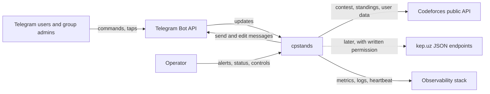

# System Architecture

Scope: release R1 (REQ-001 to REQ-022, REQ-N01 to REQ-N10). R2 and R3 are designed for but not built. Domain terms (DOM-001 to DOM-020) come from stage 05.

## System context

External actors: Telegram users (end users), the operator (single maintainer), Codeforces and kep.uz (data sources), Telegram (delivery channel).

## Containers

| Container | Technology | Responsibility |
|---|---|---|
| `bot` | Python 3.13, aiogram 3.31 (EVID-014) | Receives updates, handles commands and callbacks, renders texts, sends and edits messages |
| `ingest` | Python, httpx | Fetches contests and standings from sources, normalizes them, writes snapshots and events |
| `scheduler` | Python | Plans reminders and refresh cycles, claims due jobs, triggers delivery |
| `notifier` | Python | Turns events into per-chat alerts, batches them, enforces Telegram rate budgets, performs idempotent sends |
| `db` | PostgreSQL 16 | Single source of truth: chats, watch lists, contests, snapshots, events, jobs, deliveries, health |
| `obs` | Prometheus-compatible metrics, structured JSON logs, uptime heartbeat | Observability and alerting |

`bot`, `ingest`, `scheduler` and `notifier` ship as one modular application (one image) with separate async tasks and a role flag, so they can run in one process now and be split into separate processes later without code changes (AD-2). There is no message broker and no Redis: PostgreSQL provides queues (row-claiming with `FOR UPDATE SKIP LOCKED`), leader election (advisory locks) and durable state (AD-3).

## Components

Inside the application (names follow the domain contexts):

- **Contest Data**: `SourcePort` interface with a `CodeforcesSource` adapter (kep.uz adapter in R3); a rate-governed HTTP client; a streaming parser that keeps only rows of watched handles; a normalizer producing `Contest` and `ParticipantResult` records; a `SourceHealth` tracker.
- **Tracking**: chat setup flow, watch-list service, admin check (cached Telegram role lookup), language and time-zone settings.
- **Notification**: event detector (diff of the previous and current snapshots producing `SolveEvent` facts with deterministic keys), reminder planner, standings renderer (uz, ru, en), alert batcher, delivery executor with token-bucket rate limiting.
- **Privacy**: data inventory, deletion executor, retention jobs.
- **Platform**: configuration (environment-based), i18n catalog with completeness test, structured logging, metrics, health endpoint, operator commands.

## Deployment

| Environment | Where | Notes |
|---|---|---|
| Development | developer machine, Docker Compose | Telegram test bot or replayed fixtures; long polling |
| Beta and first public release | the maintainer's home PC, Docker Compose with restart policy, Windows sleep disabled, auto-start, long polling | Owner decision 2026-11-08: no formal availability target (best effort, REQ-N04 amended); availability is measured and published; a UPS and an external heartbeat are recommended |
| Dedicated host (future) | a VPS or equivalent always-on host, Docker Compose, webhook behind a reverse proxy | Adopted when the 99.9 percent target is wanted; a documented migration, not a redesign |

One image runs everywhere; configuration comes from environment variables and `.env` (never committed). Database migrations run as a separate, explicit step. Backups: nightly encrypted logical dump plus WAL archiving once on the production host; restore is rehearsed (stage 10).

## Data flow

1. **Ingest loop** (per source): the scheduler asks `ingest` for the active contests (phase CODING, SYSTEM_TEST, or recently FINISHED) that at least one active chat watches. For each, one shared standings fetch serves all chats, with an adaptive interval (short during CODING, longer in testing and after the end) inside the rate budget (REQ-N07, EVID-012). The parser streams the response and keeps only watched handles (EVID-002 forbids server-side filtering; EVID-003 sizes the payload).
2. **Diff and events**: the new snapshot is compared with the stored one in one transaction; new `SolveEvent` records are inserted with unique keys, so replays create nothing (invariant 5 of the domain model).
3. **Delivery planning**: for each event and each chat that watches the handle, a delivery job is inserted in the same transaction (transactional outbox). Standings changes mark `(chat, contest)` as dirty.
4. **Notifier**: claims due jobs; alerts are batched per chat inside a short window; standings edits use latest-state-wins coalescing per `(chat, contest)`; sends go through per-chat, per-group and global token buckets (EVID-009); Telegram errors are classified (retry, drop, chat gone) and recorded.
5. **Reminders**: the scheduler creates `Reminder` rows when a chat joins or a contest appears or changes; due reminders are claimed and sent with `date_time` entities (EVID-008); contest changes cancel or move pending rows.
6. **Commands**: `bot` handles updates (long polling in dev and beta, webhook in production), reads and writes `db`, and answers from stored data; slow or remote work is queued, never done inside the handler.

Standings freshness (REQ-N01) is bounded by: fetch interval, parse time, edit queueing. Alert latency (REQ-N03) is bounded by: fetch interval plus notifier batching window.

## Integrations

| Integration | Direction | Notes |
|---|---|---|
| Telegram Bot API | in and out | Webhook with secret header in production; long polling elsewhere; Bot API 10.3 features per EVID-008 |
| Codeforces public API | out | Anonymous reads; bare `contestId` for standings (EVID-002); at most one request per two seconds per instance (EVID-012); caching and backoff |
| kep.uz | out (R3) | Behind `SourcePort`; disabled by flag until written confirmation exists (EVID-010, EVID-011) |
| Observability | out | Metrics endpoint, JSON logs, external heartbeat (dead-man's switch) |
| Telegram Serverless | not used | Evaluated and rejected as the backend: no scheduler, JavaScript only, undocumented limits and pricing (EVID-015); may be reconsidered for a future Mini App backend |

## Security boundaries

- Trust boundaries: Telegram to `bot` (untrusted input, verified by webhook secret and update schema), `ingest` to sources (untrusted data, schema-validated), operator surface (owner-only, by Telegram id).
- Secrets: bot token and webhook secret only in the environment or a secret store; never logged; never in the repository; the repository ignores `.env`.
- Least privilege: database roles split into migration, application and read-only; the container runs as non-root; no inbound ports other than the webhook endpoint.
- Data: public handles, Telegram ids and settings only (REQ-013, REQ-N06); message text is never stored; logs omit content.
- Supply chain: pinned dependencies, automated vulnerability scanning in CI, signed release images where available (REQ-N09).
- Abuse: per-user and per-chat command rate limits; handle validation; watch-list limits (REQ-012).

## Reliability / scalability

- Durability: all state in PostgreSQL; jobs and deliveries are rows, so a crash loses no work; at-least-once processing with idempotent effects (unique keys, edit-or-create rule).
- Failure handling: source errors raise staleness, standings show data age (REQ-022), operator alerts fire (REQ-020); a Telegram flood limit triggers backoff, not dropped alerts; the system can pause a source or a chat (REQ-019).
- Recovery: processes are stateless; on start they resume from the database; leader election prevents duplicate schedulers.
- Capacity (planning figure, REQ-N05): 500 chats and 20 000 watched handles; one standings fetch per active contest regardless of chat count, so load grows with contests, not chats. Telegram budgets, not CPU, are the limit: about 20 messages per minute per group.
- Scale-out path: separate roles into processes, then add replicas for `notifier` workers (job claiming is safe by design); the single-writer scheduler stays leader-elected.
- Degradation order under stress: keep reminders and alerts first, standings edits second (coalesced), cosmetic features last.

## Key trade-offs

| Decision | Chosen | Alternative | Why |
|---|---|---|---|
| Runtime | Python + aiogram | TypeScript, Go | Fastest Bot API 10.3 support (EVID-014), maintainer fit, adequate performance for the load |
| Topology | Modular monolith, one image | Microservices | One maintainer; fewer moving parts; clean seams for later splitting |
| Queue | PostgreSQL | Redis, RabbitMQ, SQS | One stateful component to run, back up and monitor; transactional outbox; load is small |
| Data path | Shared full-standings fetch, local filter | Per-handle polling | Server-side filtering is forbidden (EVID-002); per-handle polling cannot meet freshness at one request per two seconds |
| Telegram intake | Long polling (home PC), webhook on a dedicated host | Webhook only | Home PC has no inbound exposure; webhook once hosted properly |
| Hosting | Home PC for beta and first public release, dedicated host later | Telegram Serverless, PaaS, VPS now | Owner chose the home PC; Serverless lacks a scheduler (EVID-015); the home PC cannot guarantee a formal availability target, so none is promised |
| Message model | Edit in place with coalescing | New message per update | Matches the product principle and Telegram rate limits |

## Architecture decisions

Summary of decisions to be recorded as formal records in stage 07: AD-1 Python and aiogram; AD-2 modular monolith in one image; AD-3 PostgreSQL as store and queue, no Redis; AD-4 shared-fetch data path with local filtering; AD-5 edit-in-place with latest-state-wins coalescing; AD-6 long polling in beta and webhook in production; AD-7 hosting phases (home PC for beta and first release with best-effort availability, dedicated host later); AD-8 Telegram Serverless not used as the backend; AD-9 observability stack and alerting; AD-10 i18n catalogs with a completeness test.

## Traceability to requirements

| Requirement | Architectural elements |
|---|---|
| REQ-001, REQ-002, REQ-003, REQ-022 | Contest Data ingest, snapshot diff, standings renderer, edit coalescing, staleness notice |
| REQ-004, REQ-005, REQ-006 | Scheduler and reminder planner, `date_time` entities, contest change handling |
| REQ-007, REQ-008, REQ-009, REQ-010 | Event detector, transactional outbox, alert batcher, tone catalogs, upsolve limits of the source |
| REQ-011, REQ-012, REQ-013, REQ-021 | Tracking components, admin check, input validation, no-secrets design |
| REQ-014, REQ-015, REQ-016 | i18n catalog and completeness test, time-zone setting, `/upcoming` from stored contests |
| REQ-017, REQ-018 | Privacy component, deletion executor, data inventory |
| REQ-019, REQ-020 | Operator surface, health and alerting |
| REQ-N01, REQ-N03 | Adaptive fetch interval, streaming parser, batching window, token buckets |
| REQ-N02, REQ-N04 | Durable jobs, leader election, restart policy, host hardening, published availability measurement |
| REQ-N05 | Single shared fetch per contest, role splitting path |
| REQ-N06, REQ-N09 | Security boundaries, data minimization |
| REQ-N07 | Rate-governed HTTP client |
| REQ-N08, REQ-N10 | Observability components, CI gates, tests |

## Assumptions

- Codeforces will keep serving full standings anonymously within the documented rate (EVID-002, EVID-012); a tightening is handled by degradation and monitoring.
- Telegram limits in EVID-009 are accurate and per bot; they must be verified before the notifier budgets are fixed.
- One application instance is enough for R1 load; the scale-out path is not needed before launch.
- The home PC is acceptable for the beta and the first public release under a best-effort commitment; users are told so in the README and status messages.

## Open questions

- When the project moves to a dedicated host: which provider and region (cost, latency to Telegram and Codeforces)?
- Is ETag, `If-Modified-Since` or response size monitoring available on the Codeforces endpoint to avoid downloading unchanged 7 MB bodies?
- Which uptime and alerting services are acceptable (free tiers versus self-hosted)?
- How should the owner be alerted if the bot itself is down (second channel)?

## Approvals

The owner approved this architecture on 2026-11-08 (Saidakbar Narzullayev): Python 3.13 with aiogram 3.31, modular monolith in one image, PostgreSQL as store and queue without Redis, shared full-standings fetch with local filtering, edit-in-place delivery, and Telegram Serverless not used as the backend.
The owner also chose to stay on the home PC for the beta and the first public release and to adopt no formal availability target (best effort), which amends METRIC-004 in stage 01 and REQ-N04 in stage 04. Formal records are stored under `.project-alpha/decisions/` and `.project-alpha/approvals/` (approvals APR-006 and APR-007).
